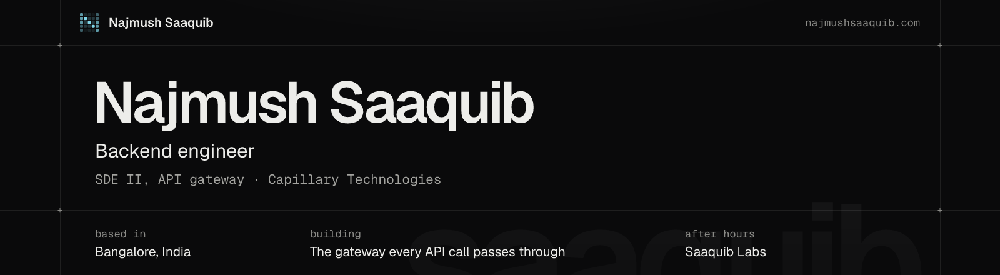

  

  
  
  
  
  

Hi, I'm Najmush. I'm a backend engineer with four years of Java microservices and event-driven
systems behind me. I'm a **Software Development Engineer II at Capillary Technologies**, working
on the **API gateway**: the front door of Capillary's platform, which every API call passes
through before it reaches anything else.

After hours I run **[Saaquib Labs](https://saaquiblabs.com)**, a small studio where I build careful
software for the communities big platforms overlook. I'm also studying for a B.Sc in Data Science
and Applications at **IIT Madras**.

## 🛠️ At work

**Now · Capillary Technologies** (Jan 2026 – present)

Capillary runs loyalty and customer programs for 400+ brands in 30+ countries. Every request into
that platform, from a brand's app, a store's till or a partner's system, goes through the gateway
first.

- **Checked at the door**: every client and every token, verified once, before anything else runs.
- **Fair under load**: rate limits that keep one busy brand from slowing everyone else down.
- **To the right place**: each call routed to the right service and the right version of the API.
- **Before the gateway, Platform and Infra**: AWS infrastructure, service performance and distributed-system reliability. Took ownership of FT Extensions, a critical platform service only one architect knew, mapped it end to end and proposed an automated test suite for it.

**Before · NoBroker Technologies** (Jul 2022 – Jan 2026, Senior SDE from 2025)

- **Built a B2B subscription system end to end**: billing, scheduling and partner allocation for a new enterprise line of business. ₹48L+ in new revenue.
- **Designed Redis-backed real-time APIs** behind the public homepage, for 100K+ daily users. Lower latency, and view-to-click doubled.
- **Built event-driven Kafka pipelines** that moved real-time work off the request path and cut API response times by 60%.
- **Led the "My Bookings" revamp**, bringing bookings, cancellations, rescheduling, refunds and subscriptions into one system.
- **Put SMS, WhatsApp and email behind one API**, so support sees the whole conversation.

## 🌱 Built at Saaquib Labs

What the studio has shipped so far. All of it lives at [saaquiblabs.com/work](https://saaquiblabs.com/work).

<table>
  <tr>
    <td align="center" width="25%">
       
      <a href="https://mihrabummah.com"><b>MihrabUmmah</b></a> 
      Find an Imam or a Quran teacher nearby, by credential and city
    </td>
    <td align="center" width="25%">
       
      <a href="https://d-tox.saaquiblabs.com"><b>D-Tox</b></a> 
      YouTube for what you came for: no feed, no Shorts, no autoplay
    </td>
    <td align="center" width="25%">
       
      <a href="https://github.com/saaquiblabs/lost-buttons"><b>Lost Buttons</b></a> 
      A mouse's Back and Forward buttons, working on the Mac
    </td>
    <td align="center" width="25%">
       
      <a href="https://curtain.saaquiblabs.com"><b>Curtain</b></a> 
      Brightness for every screen, and a switch to turn any of them off
    </td>
  </tr>
</table>

## 🧰 Toolbox

  

> I like systems that are simple, observable, and hard to break.
